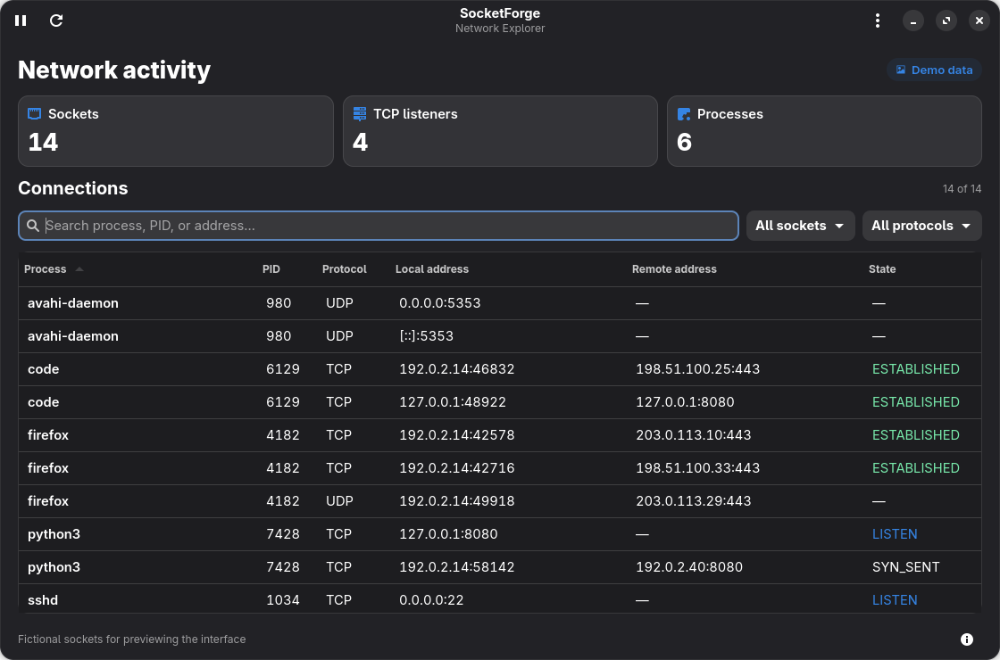

# SocketForge

SocketForge is a native GNOME app for inspecting local TCP and UDP sockets on Fedora. The v0.1 Network Explorer shows which processes own visible sockets, where they communicate, and which TCP sockets are listening.



## Run on Fedora

From the repository directory, install the runtime dependencies and launch the app.

```sh
sudo dnf install gtk4 libadwaita python3-gobject python3-psutil
/usr/bin/python3 -m socketforge
```

SocketForge uses GTK4 and Libadwaita 1.8 or newer. Run `/usr/bin/python3 -m socketforge --demo` to explore the interface with fictional data without reading host sockets.

To add SocketForge to the GNOME app grid, run `make install` from the repository directory. This installs a launcher and icon under `~/.local`. Run `make uninstall` to remove them along with the installed app files.

## Explore sockets

- Search by process name, PID, address, port, state, or executable path. Click a column header to sort.
- Use **TCP listeners** to inspect sockets in the `LISTEN` state. **Bound UDP** shows UDP sockets with a local address and no peer.
- Open a row to see its address family, executable path, and full endpoints. The details view also exposes fields hidden from the table at narrow widths.
- Press **Ctrl+P** to pause or resume the two-second refresh. **Ctrl+R** takes a fresh snapshot even while paused. **Ctrl+F** focuses search.

SocketForge reads snapshots with psutil and runs as your regular user. Linux permissions and the current network namespace limit which sockets and process details are visible. Short-lived connections can occur between snapshots. A wildcard bind such as `0.0.0.0:22` means the service listens on all local IPv4 interfaces. Firewall and routing rules determine whether another machine can reach it.

## Roadmap

- **0.2 · Process Inspector** — group sockets by process and expand process details.
- **0.3 · Security Monitoring** — detect new endpoints and listening sockets, with optional history.
- **0.4 · Network Analytics** — explore per-process bandwidth and event tracing on supported systems.
